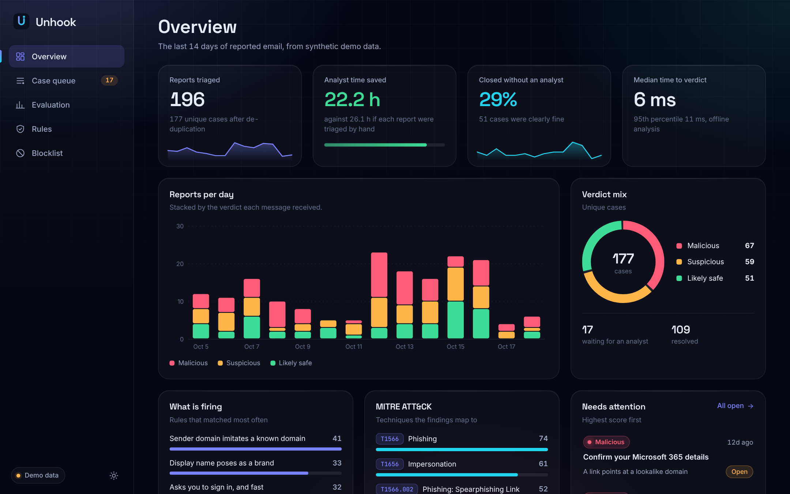
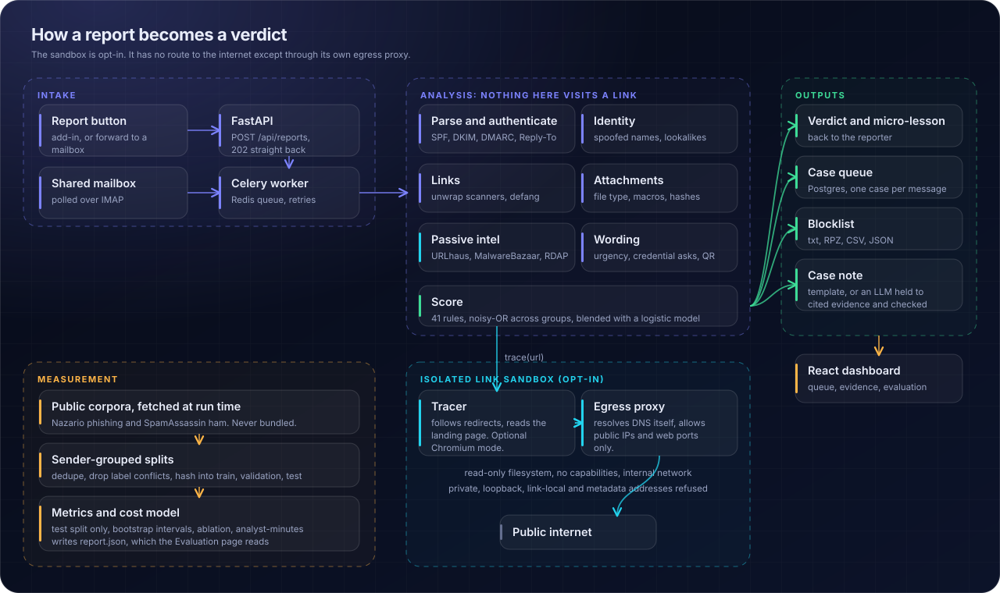
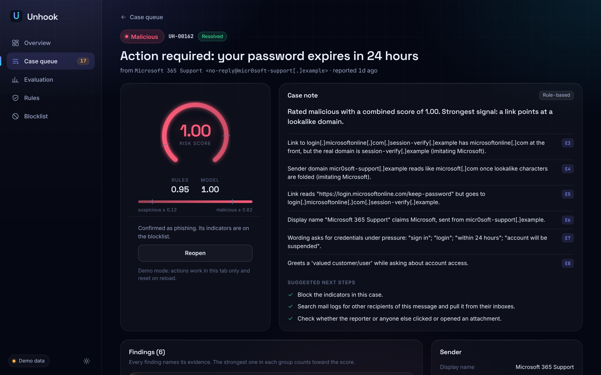
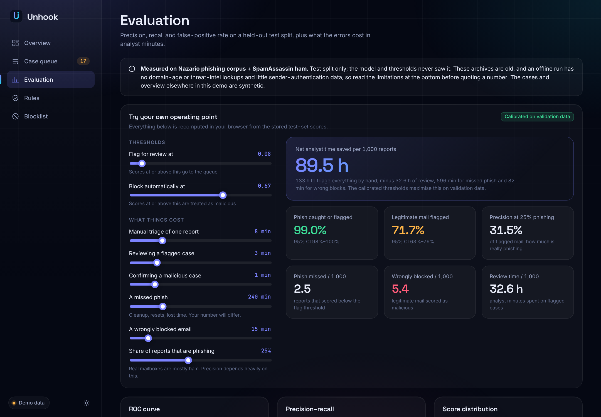
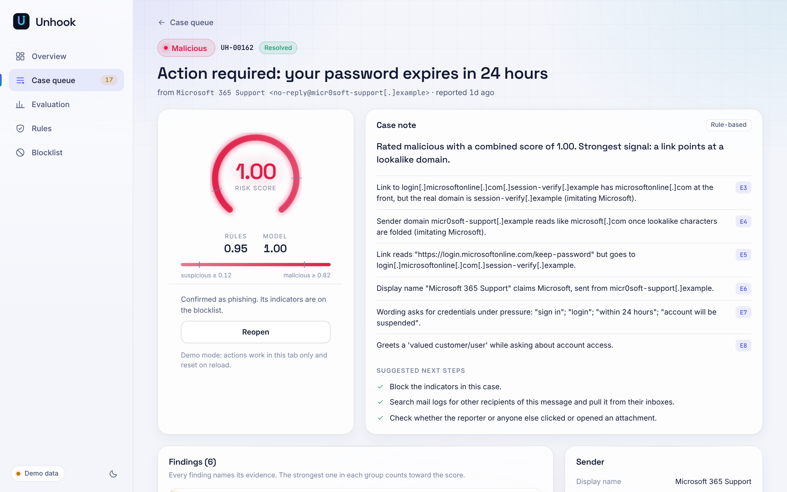

<p align="center">
  
</p>

<p align="center">
  <a href="https://github.com/Twisha32/unhook/actions/workflows/ci.yml"></a>
  <a href="LICENSE"></a>
  
  
</p>

# Unhook

Unhook is a phishing triage pipeline for organisations that get suspicious email but don't have a security operations centre to read it. A staff member forwards a message to a mailbox (or a script or add-in posts it to the API), and within seconds they get a plain-English answer with one small lesson attached. An analyst gets a case with the evidence laid out, and the network team gets a blocklist they can import.

It's built for the school district, clinic or small nonprofit where "the SOC" is one person who also fixes printers.

**Live demo:** [twisha32.github.io/unhook](https://twisha32.github.io/unhook/) runs the real dashboard on synthetic data, so you can click through cases and move the cost sliders without installing anything. The cases are synthetic; the Evaluation page shows the real run.

<p align="center">
  
</p>

## What it does

1. **Takes the report.** Over the API, an `.eml` uploaded in the dashboard, a forwarded message (the original is unwrapped), or an IMAP mailbox. The same message reported twice is one case.
2. **Reads the email the way an analyst would.**
   - SPF, DKIM and DMARC results, plus Reply-To mismatches and display names that borrow a brand or a person's name (your CEO, say).
   - Lookalike and homoglyph domains: `micr0soft`, `paypa1`, Cyrillic `а`, brand-plus-filler combos like `ridgewood-usd-hr`, and brand names buried in subdomains.
   - Links: where the visible text and the real target disagree, IP-address hosts, shorteners, free hosting, and the whole redirect chain if you turn the sandbox on.
   - Attachments: sniffed file type vs. the name it wears (`Invoice.pdf.exe`), Office macros via `oletools`, active PDFs, HTML smuggling, encrypted archives.
3. **Checks the outside world passively.** Domain age over RDAP, URLhaus and MalwareBazaar lookups, and local feed files. None of these touch the suspicious link.
4. **Scores it transparently.** 41 rules, each with a confidence, a plain-language lesson and a MITRE ATT&CK technique (T1566 and friends). A logistic-regression model adds a second opinion and explains exactly which features moved its score. Both are shown side by side so nobody has to take the number on faith.
5. **Responds.** The reporter gets a verdict and a micro-lesson. Clearly malicious mail goes straight to the blocklist. Suspicious mail waits for an analyst. Clearly fine mail closes itself, unless you switch that off. Marking a case as a false positive takes its indicators off the blocklist again.
6. **Writes the case note.** Either a deterministic template or, optionally, an LLM. The LLM only sees numbered evidence extracted by the parser, and every claim it makes is checked against that evidence before anyone reads it. A draft that invents a domain, a number or an attack technique is thrown away and replaced by the template.

<p align="center">
  
</p>

## Screenshots

<p align="center">
  
</p>

<table>
  <tr>
    <td width="50%"></td>
    <td width="50%"></td>
  </tr>
  <tr>
    <td align="center"><sub>Evaluation: curves, ablation and a cost model you can argue with</sub></td>
    <td align="center"><sub>Light theme</sub></td>
  </tr>
</table>

Every URL in the dashboard is defanged and copy-only. Nothing in it is an anchor, so nobody can click through to a phishing page by accident.

## Try it

You need Python 3.11+. Node 20+ is only for the dashboard, and Docker only for the full stack.

**1. The engine, with no services at all**

```bash
git clone https://github.com/Twisha32/unhook && cd unhook
make setup && source .venv/bin/activate

unhook samples                                   # 17 hand-written messages, each with an expected verdict
unhook analyze samples/13-homoglyph-apple-id.eml # evidence, scores, ATT&CK techniques
```

The samples are fictional (reserved `.example` domains, documentation IP ranges). Nothing in them is live.

**2. API and dashboard on your machine**

```bash
UNHOOK_ORG_DOMAINS=ridgewood-usd.example make dev-api     # :8000, SQLite, tasks run inline, no Redis
cd dashboard && npm ci && npm run dev                      # :5173, proxies /api to :8000

curl -F file=@samples/01-m365-password-expiry.eml -F reporter=pat@ridgewood-usd.example \
     localhost:8000/api/reports
```

Open `http://localhost:5173`, and the case is waiting in the queue.

**3. The full stack (Postgres, Redis, worker, API, dashboard)**

```bash
cp .env.example .env        # set UNHOOK_ORG_DOMAINS, POSTGRES_PASSWORD and an API token
docker compose up --build   # dashboard on :8080, API on :8000
```

Add `--profile ingest` to poll a reporting mailbox, and `--profile sandbox` for active link tracing (set `UNHOOK_SANDBOX_URL=http://sandbox:8080` in `.env`).

## The numbers, and what they do and don't mean

The evaluation harness is the part of this project most worth poking at.

- **Held-out public data.** The real run trains and tests on the [Nazario phishing corpus](https://monkey.org/~jose/phishing/) (CC BY 4.0) against the [SpamAssassin](https://spamassassin.apache.org/old/publiccorpus/) ham sets. Both are downloaded at run time and never committed.
- **No memorising a campaign.** Messages from the same sender domain always land in the same split, near-duplicates are collapsed, and a text filed as both phishing and legitimate is dropped as label noise. The model is fit on train, the blend and thresholds are chosen on validation, and every reported number comes from the test split.
- **Honest intervals.** 95% confidence intervals come from resampling whole sender groups, because two messages from one sender aren't independent.
- **Ablation and per-rule precision.** Rules only, model only, and the blend are reported separately, along with each rule's precision on the test data.
- **A business model, not just a confusion matrix.** Errors are priced in analyst-minutes: a missed phish costs far more than a false alarm. The headline is `net minutes saved per 1,000 reports`, which subtracts the cost of mistakes. The "gross" figure (review time saved) is shown too, but it's the flattering one and it can make a tool that misses most phish look good. Every assumption is a slider in the dashboard, and the cost defaults are placeholders for a small organisation, not measurements.

**What the first real run says.** The 17 October 2026 run read 15,427 messages and removed 4,779 near-duplicates. The test split is 1,107 phishing and 551 legitimate messages from senders the model never saw. The default cost assumptions apply, and the full report is in [`eval/results`](eval/results/nazario-spamassassin.json).

| | Result |
|---|---|
| Auto-block threshold | 99.5% precision, 78% recall, 4 wrongful blocks among 551 legitimate messages |
| Review-queue threshold | Catches 99.0% of phishing (95% CI 98.3 to 99.6%), but also flags 71% of legitimate mail (CI 63 to 79%). At 25% prevalence, about 32% of flagged mail is really phishing. |
| Net analyst time | 5,377 minutes saved per 1,000 reports (6,055 gross), with 2.5 missed phish and 5.4 wrongful blocks per 1,000 |
| Rules alone | AUC 0.76, 67% recall, 28% of legitimate mail flagged. Net **-13,007** minutes per 1,000, which under these costs is worse than triaging by hand. |
| Model alone | AUC 0.97 |

Read that with some suspicion, in both directions:

- **The queue is noisy by design.** The cost model prices a missed phish at 240 minutes and a review at 3, so the optimiser flags almost everything. That's cheap in minutes and irritating for a person. Raise the threshold in the dashboard and watch recall fall.
- **The rules are weak on this data.** They were written for modern lures, and an offline run on these archives has no domain-age or threat-intel lookups and little sender-authentication data, which many rules lean on. Two rules are plainly noisy on it: Reply-To mismatch (33% precision, because mailing lists set Reply-To on purpose) and fake reply threads (46%). They haven't been tuned against this test split, because that would spoil the split.
- **The model's 0.97 probably flatters it.** The legitimate mail is from 2002 to 2005 and much of the phishing is newer, so a model can learn the era (formatting, HTML, link counts) instead of learning phishing. It hasn't been tested on current legitimate mail.
- **So no trained model ships.** Out of the box Unhook runs on the rules alone, which is the weaker configuration above. Until you've evaluated it on your own labelled reports, consider `UNHOOK_AUTO_CLOSE_SAFE=false` so an analyst still sees everything the rules call safe.

To reproduce or rerun:

```bash
unhook corpora fetch --dest data/corpora
unhook eval --corpus real --data data/corpora --out eval/reports/latest.json --write-model model/model.json
```

or run **Evaluate on public corpora** from the Actions tab, which does the same on a GitHub runner and publishes the report and trained model to an `eval-results` branch. Method and corpus caveats are in [docs/evaluation.md](docs/evaluation.md).

## Safety

Unhook is a defensive tool, and it's built so that analysing a phishing email never means visiting its links from a machine you care about.

- **Passive by default.** Out of the box, links are judged from the email alone plus third-party databases (RDAP, URLhaus, MalwareBazaar). The suspicious site is never contacted.
- **Active tracing is opt-in and jailed.** If you enable the sandbox, redirects are followed inside a container that has no route to the internet except through an egress proxy. The proxy only connects to public addresses, so a phishing link can't be used to poke at your internal network or a cloud metadata endpoint. It refuses private, loopback, link-local and similar ranges, judges the addresses a name *resolves to* rather than the name, restricts ports, and caps body sizes.
- **Samples are fictional.** No real phishing kit, page or live URL is in this repository, and nothing here builds one.
- **Evidence is defanged** wherever a person might see it.
- **Blocking is conservative.** Only confident verdicts are blocked automatically, shared platforms such as Google Forms are only ever blocked by exact URL and never by domain, your own domains and major brands are never exported, and a false-positive verdict reverses the block.

The full threat model, including the trade-off of running Chromium with `--no-sandbox` inside the jail, is in [docs/safety.md](docs/safety.md).

## Configuration

Everything is optional and set through environment variables (or `.env`). The full annotated list is in [.env.example](.env.example).

| Variable | What it does |
|---|---|
| `UNHOOK_ORG_DOMAINS` | Your own domains. Mail that lookalikes them is treated as impersonation. |
| `UNHOOK_PROTECTED_NAMES` | People attackers like to pretend to be (comma separated). |
| `UNHOOK_API_TOKEN` | Bearer token for the API. Leave empty only on localhost. |
| `UNHOOK_URLHAUS_AUTH_KEY`, `UNHOOK_BAZAAR_AUTH_KEY` | Free abuse.ch keys that switch on those lookups. |
| `UNHOOK_URLHAUS_FEED_PATH` | A local hostfile, URL list or OpenPhish-style feed. |
| `UNHOOK_SANDBOX_URL` | Turns on active link tracing. Empty means links are never visited. |
| `UNHOOK_SANDBOX_MODE` | `http` (redirects and page text) or `browser` (also runs the page in headless Chromium). |
| `UNHOOK_SMTP_*` | Where replies to reporters are sent from. Without it they're logged. |
| `UNHOOK_IMAP_*` | The reporting mailbox for `--profile ingest`. |
| `UNHOOK_CASE_NOTE_PROVIDER` | `template` (default, offline) or `anthropic`. Needs `UNHOOK_BUILD_EXTRAS=llm` and `ANTHROPIC_API_KEY`. |
| `UNHOOK_AUTO_CLOSE_SAFE` | `true` (default) closes "likely safe" cases without an analyst. `false` keeps every report in the queue. |
| `UNHOOK_MANUAL_REVIEW_MINUTES` | What reading one report by hand costs, for the time-saved figure. |

## API

| Method and path | Purpose |
|---|---|
| `POST /api/reports` | Submit a message (multipart `file`, or a raw `message/rfc822` body). Returns an id immediately. |
| `GET /api/reports/{id}` | The reporter's verdict, message and case reference. |
| `GET /api/cases`, `GET /api/cases/{id}` | The analyst queue and a full case with evidence. |
| `PATCH /api/cases/{id}` | Assign, resolve, or mark as a false positive. |
| `POST /api/cases/{id}/note` | Regenerate the case note. |
| `GET /api/blocklist/{txt,rpz,csv,json}` | Export indicators: a plain domain list, a DNS response policy zone, CSV, or JSON. |
| `GET /api/indicators`, `/api/rules`, `/api/stats/overview`, `/api/eval/latest` | What the dashboard reads. |

Interactive docs are at `/api/docs` when the API is running.

## Repository layout

```
backend/       FastAPI app, Celery tasks, analysis engine, case workflow, evaluation harness
  unhook/analysis/   parser, auth, lookalikes, URLs, attachments, intel, rules, model
  unhook/response/   verdict messages, lessons, case notes, blocklist export
  unhook/eval/       corpus loaders, metrics, cost model, fabrication tests
sandbox/       isolated link tracer, egress proxy, optional Chromium mode
dashboard/     React + Vite + TypeScript, no UI framework, hand-built SVG charts
samples/       17 fictional messages with expected verdicts
scripts/       regenerates the samples deterministically
docs/          architecture, safety model, evaluation notes, images
```

## Testing

```bash
make test       # backend and sandbox suites
make lint       # ruff
make samples    # every sample still gets the verdict in samples/manifest.json
make notes-check  # seeded fabrications in case notes are all caught, faithful notes never rejected
```

Every rule has one message that must trigger it and one that must not, and a meta-test fails if a rule is added without both. CI runs the backend, sandbox and dashboard builds and validates the Docker Compose file on every push.

## Known limits

- The IMAP poller is covered by a stubbed-connection test, not against a real mail server.
- CI starts the full compose stack on every push, reports a sample through it, and checks that the egress proxy refuses the cloud metadata address. What hasn't been observed is the sandbox tracing real phishing sites, and the Chromium mode is only tested against local servers.
- There's no database migration tooling yet. The schema is created on start-up, which is fine for a first deployment and not for upgrading one.
- A rules engine written by the people reading the corpus will always flatter itself. Treat the first real numbers as an upper bound.
- Email only. No SMS, no chat-app reports.

## Credits and licensing

Code is MIT licensed. The Nazario corpus is by Jose Nazario under CC BY 4.0. The SpamAssassin public corpus has no formal licence; its readme says copyright stays with the original senders and asks that the messages not be sent into live mail systems, so Unhook reads it from disk for research and never redistributes it. Brand names in the lookalike checks and samples are used only to describe what is being impersonated.
